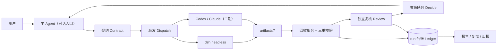

# 设计：dsh-conductor

> 状态：设计稿 v0.2（对应 P0 试点后的修订方向）。目的：把「一个对话入口 + 后台多 Agent」从口头约定变成可验证的执行协议。

## 1. 问题

DSH 已经能在一个会话里调用工具、派子任务；但当用户同时使用多个 Agent（DSH / Codex / Claude 等）时，四件事仍然靠人肉：

1. **派发**：没有统一的任务契约，任务说明散落在对话里；
2. **回收**：结果在聊天窗口与文件系统之间搬运，无法判断是否完整；
3. **验收**：只知道进程退出码，不知道交付物是否满足验收标准；
4. **恢复**：中断后不知道做到哪一步，也不敢直接重跑。

## 2. 目标与非目标

**目标**

- 一个对话入口（不新增控制台）：用户只与主 agent 交互；
- 可执行的委托协议：契约 → 派发 → 回收 → 复核 → 决策 → 台账；
- fail-closed：缺退出码 / 超时 / 结构化结果 / 证据锚点，一律判失败；
- 可恢复：run 台账 append-only、可重放，中断后可续跑；
- 本地优先：数据落工作区，默认不出网。

**非目标**

- 不做 Agent 编排器（不替代官方 Agent Teams / workflow）；
- 不做实时监控看板或新的控制台；
- 不替用户做决策（高风险动作仍由人批准）；
- 不保存完整聊天正文（只保存工作事实与产物索引）。

## 3. 六个模块

### 3.1 契约 Contract

任务进入派发前必须生成的 JSON（Schema 见 `templates/contract.schema.json`）：

| 字段 | 说明 |
|---|---|
| `version` | 契约格式版本 |
| `run_id` | 本次 run 唯一标识 |
| `intent` | 一句话目标 |
| `source[]` | 只读输入材料（路径 + 版本/哈希） |
| `write_scope[]` | 允许写入的目录（白名单） |
| `dimensions[]` | 并行分析维度（如 product / technical / risk） |
| `execution` | 并行数、复核数、最少 dsh 路数、结果通道、失败后是否降级 |
| `evidence` | 证据锚点要求（路径 + 行号 + 原文引用，需机器校验） |
| `negative_acceptance[]` | 负向用例（应当被拒绝/应当失败） |
| `failure_injection[]` | 必须被判定失败的注入类型 |
| `pass_requires[]` | 通过条件（退出码、超时、结构化结果、证据） |
| `failure_policy` | 失败后的行为（记录 blocker、停止、不重试掩盖） |
| `review_categories[]` | 复核分类（已证实 / 待验证 / 分歧） |
| `metrics[]` | 需采集的指标（耗时、回收完整性、失败暴露、打断次数、成本） |
| `constraints[]` | 不可违反的约束（只读、不发布、不改原文…） |
| `limits[]` | 明确声明未验证的能力（如恢复、成本口径） |

### 3.2 派发 Dispatch

- 一期执行器：`dsh --profile headless`（通过标准输入传任务，独立 `DSH_HOME` 与工作目录）；
- 结果通道：产物写 `runs/<id>/artifacts/<role>/`，不通过聊天窗口回贴；
- 每步记录：`prompt.txt`、`stdout.txt`、`status.json`（退出码、超时、耗时、清理结果）；
- 取消与清理：超时/失败后终止进程树，清理结果单独留痕（不能假定后代已退出）。

### 3.3 回收 Collect

三重校验，缺一即 `failed`：

1. 退出码为 0；
2. 未超时；
3. 结构化结果存在且通过校验：JSON 可解析（允许推理文本夹带）、必填字段齐全、`run_id` / `role` 匹配。

> 已知限制：三重校验只证明“进程层正常结束”，不证明“内容正确”。内容正确性依赖独立复核与证据锚点校验，不能把 fail-closed 等同于结论正确。

### 3.4 复核 Review

- 独立 reviewer 会话：读取三路结论与**原始证据**（不是执行者摘要）；
- 证据锚点校验：路径存在、行号在范围内、引文与对应行一致；
- 严重性校准：确认 / 降级 / 待验证 / 分歧；
- 负向用例：检查类任务必须跑“应当拒绝”的路径。

> 待补：复核隔离强度（是否盲评、是否使用不同模型、抽查比例与必查项）需要写进契约，避免“自己复核自己”。

### 3.5 决策 Decide

- 需要人拍板的事项汇总成卡片（聊天内），附选项与证据；
- 无人响应时的默认动作、超时与升级规则需在契约中显式声明；
- 高风险动作（发布、权限变更、删除）必须等待明确批准。

### 3.6 台账 Ledger

```text
runs/<run_id>/
├── spec.json        # 契约实例
├── spans.jsonl      # 步骤事件（append-only）
├── status.json      # 每步状态与失败原因
├── report.md        # 本次 run 报告
├── heartbeat.json   # 心跳与当前状态
└── artifacts/<role>/
```

- 可重放：由 spans 重建状态与报告；
- 可审计：每条结论可回溯到证据锚点与执行日志；
- 恢复：以步骤状态机 + 幂等键保证续跑不重复副作用（M3 实现，P0 未验证）。

## 4. 架构



## 5. 兼容性与安全

- DSH 处于开发者预览期：事件/接口可能变化，adapter 需要版本探测与降级；
- 权限：派发前列出将读写的目录与命令；后续实现沙箱/allowlist/egress 策略（当前仅声明，未实现强制边界）；
- 隐私：产物与日志落本地；如使用云端模型，内容会离开本机，需在契约中声明；
- 恢复：心跳与状态文件不等于恢复能力，恢复需要幂等键与副作用核对。

## 6. 与官方能力的关系

| 能力 | 官方 DSH | dsh-conductor |
|---|---|---|
| 子 agent / Agent Teams | ✅（实验） | 作为执行器复用，不重造 |
| 工作流编排 | ✅ workflow / task programs | 不竞争编排，专注**契约 + 验收 + 复核 + 台账** |
| 跨 harness | ❌ | 二期扩展 Codex / Claude |
| 可恢复 run 台账 | 部分 | 追加式、可重放、含决策与审批记录（待实现） |
| 人机决策队列 | 审批 seam | 聊天内卡片，不新增控制台 |

## 7. 设计取舍与已知缺口（P0 复核发现）

1. **托管范围**：首版只接 dsh 单链路，跨 harness 放二期——首发差异化靠验收协议而非跨产品；
2. **恢复**：`/run resume` 需要步骤状态机、幂等键、原子提交与副作用 fencing，MVP 前必须先做最小验证；
3. **权限**：当前只有“声明”，没有强制边界；后台 agent 越权仍是开放风险；
4. **产物完整性**：需增加产物清单、哈希与“声明 vs 实际”核对，避免 exit 0 + 合法 JSON 但交付缺失；
5. **成本**：token/成本口径未接入，缺失时记 `unknown`，不得视为 0；
6. **样本**：P0 为 n=1 的只读评审，稳定性需要更多真实任务样本。
